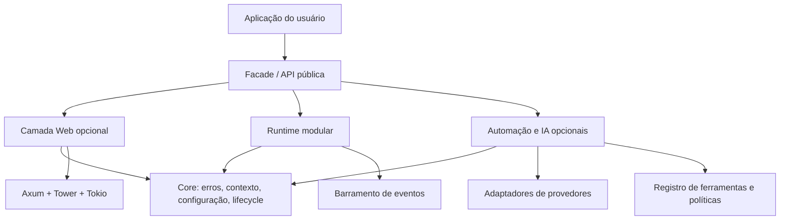

# 2. Arquitetura proposta

## Visão em camadas

## Regras de dependência

1. `core` não importa `web`, `ai` nem adaptadores externos específicos.
2. `web` pode depender de `core` e de bibliotecas HTTP consolidadas.
3. `modules` depende de `core`; integrações Web são pontes opcionais.
4. `ai` define abstrações de provider, tool, agente e tarefa sem exigir um fornecedor específico.
5. Adaptadores de provedores implementam as abstrações de `ai` e permanecem crates opcionais.
6. A facade apenas reexporta APIs selecionadas e oferece ergonomia; não deve virar um “monólito de dependências”.

## Responsabilidades por camada

### Core
- Tipos de erro e resultado.
- Contexto da aplicação e identificadores de execução.
- Configuração tipada e carregamento por fontes definidas.
- Contratos de lifecycle.
- Utilidades comuns pequenas, sem regras de negócio.

### Web
- Definição e composição do router.
- Registro de rotas por módulo.
- Estado compartilhado da aplicação.
- Middleware padrão e configuração segura.
- Conversão de erros internos em respostas públicas sem vazar detalhes sensíveis.

### Modules
- Trait de módulo e registro.
- Dependências explícitas entre módulos.
- Fases de inicialização e shutdown.
- Eventos e assinaturas.
- Detecção de módulos duplicados, ausentes ou com dependências cíclicas.

### Automation / AI
- Trait `ModelProvider`.
- Trait `Tool` com metadados e política de autorização.
- Execução de agente limitada por orçamento, prazo e número de passos.
- Runner de tarefas assíncronas com cancelamento.
- Eventos de ciclo de vida das tarefas e telemetria.

## Inicialização e encerramento

Ordem sugerida de inicialização:

1. Carregar e validar a configuração.
2. Construir o contexto global e a telemetria.
3. Registrar módulos e validar dependências.
4. Inicializar recursos na ordem topológica declarada.
5. Montar rotas e workers opcionais.
6. Iniciar o servidor.

No encerramento, parar de aceitar trabalho novo, cancelar ou drenar tarefas conforme política, chamar shutdown dos módulos em ordem inversa e liberar recursos.

## Eventos: semântica antes da implementação

A primeira versão deve definir explicitamente:
- Se os eventos são síncronos ou assíncronos.
- Se a entrega é best-effort ou exige confirmação.
- O comportamento quando um handler falha.
- Se a ordem de eventos é garantida.
- Se eventos podem ser reentrantes.
- Se o barramento é somente em memória.

**MVP recomendado:** barramento em memória, sem garantia de durabilidade, com erros observáveis e documentação clara. Persistência e entrega entre processos ficam para uma etapa futura.

## Plugins: estratégia segura

Na versão inicial, “plugin” significa extensão registrada no build ou como crate Rust, com contratos estáveis e dependências declaradas. Carregar bibliotecas nativas arbitrárias em runtime fica fora do MVP por riscos de ABI, compatibilidade e segurança. Se plugins externos forem necessários, avaliar WASM/WASI com permissões explícitas em uma fase própria.
